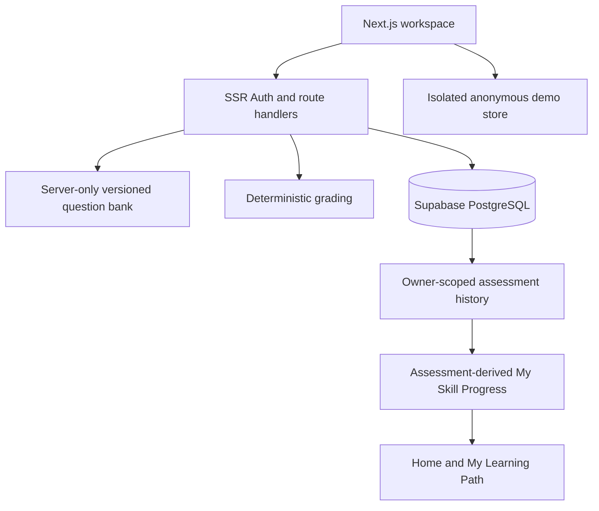

# System architecture

## Sources of truth

- `shared/data/catalog.ts` contains the four curated careers, canonical skill graph, weights, and hypothetical missions. It contains no answer keys.
- `shared/data/curriculum.ts` provides the normalized Career → Skill → Topic → Subtopic → Lesson → Resource/Practice graph without replacing canonical IDs or duplicating resource records.
- `shared/lib/curriculum.ts` strictly validates schemas, references, required relationships, unique IDs, and acyclic skill/topic prerequisites.
- `shared/data/assessment-catalog.ts` is browser-safe assessment metadata.
- `backend/lib/assessments/question-bank.server.ts` is the server-only versioned question bank and answer-key boundary.
- `backend/lib/assessments/grading.server.ts` performs trusted grading and defines the current pass threshold. Client-safe history/profile selectors remain in `shared/lib/assessments/grading.ts`.
- PostgreSQL `assessment_attempts` rows with `grading_method = 'server_quiz'` are authoritative for authenticated scores.
- `shared/lib/assessments/grading.ts` selects the latest trusted attempt per skill and computes coverage, measured performance, deltas, and descriptive categories.
- `frontend/src/store/use-skillmetry.ts` stores only anonymous demo identity/career/preferences. It is not a trusted score source.
- Supabase Auth cookies are managed with `@supabase/ssr`; private routes validate claims on the server.

## Assessment write path

1. An authenticated student starts one canonical assessment ID.
2. A service-only PostgreSQL function takes a per-owner/assessment transaction lock, expires stale sessions, optionally enforces a configured completion window, and atomically creates or resumes one owner-bound 30-minute session.
3. The client submits only the session UUID and option indexes keyed by question ID.
4. The server reloads the session by authenticated owner, verifies active status, expiry, and question-bank version, then grades against server-only keys.
5. A service-role client calls `complete_assessment_session`, which atomically consumes the active session, validates arithmetic, question count, pass threshold, and completion metadata, then inserts exactly one result.
6. Students read their own results through RLS. They cannot invoke the completion function or write result rows directly.

This path never trusts a client-supplied user ID, score, result count, pass flag, version, or review state.

## Profile read path

The history API returns only `server_quiz` attempts owned by the validated user, newest first. The client derives:

- current skill score from the latest attempt using completion time plus immutable ID as a stable tie-breaker;
- history from all completed attempts;
- coverage from the presence of assessments;
- measured performance from assessed target skills only.

Legacy rows remain stored but are marked `legacy_untrusted` and excluded.

## Domain rules

- Every career has positive weighted skills summing to 100.
- Every prerequisite references an existing canonical skill; the graph is acyclic.
- Every curriculum skill has a topic, every topic has a subtopic, and every subtopic has a lesson linked to at least one existing resource or available practice entry.
- Curriculum topic, subtopic, and lesson IDs are stable namespaced identifiers. Relationships use IDs so shared topics and future careers can reuse content instead of copying it.
- Curriculum nodes carry difficulty, ordering, learning objectives, a version, and source attribution. Published course lessons may add compatible optional curriculum metadata; existing saved course payloads remain valid.
- `undefined` means not assessed; 0 is a valid measured result.
- Passing a short quiz is not professional verification or certification.
- A scenario adjusts a copy of assessed values only and never persists a result.
- Anonymous demonstration attempts are labeled illustrative and never uploaded.

## Routes

- `/`: marketing landing.
- `/onboarding`: display name and target career.
- `/dashboard`, `/careers`, `/roadmap`, `/twin`, `/simulator`, `/missions`, `/assessments`, `/jobs`, `/passport`, `/settings`: preserved workspace routes. Student labels are Home, My Path, Learn, Practice, Progress, My Learning Path, My Skill Progress, Compare Study Plans, Projects, Job Skill Checker, and Skill Summary according to context.
- `POST /api/assessments/start`: authenticated session creation/reuse.
- `POST /api/assessments/submit`: authenticated server grading and atomic completion.
- `GET /api/assessments/history`: current user's immutable trusted history.
- `GET|PUT /api/profile`: authenticated profile persistence; no numerical skills.
- `POST /api/simulate`: deterministic hypothetical computation; no writes.
- AI and job-analysis endpoints remain explicit 501 placeholders.

## Database evolution

Migrations are additive and ordered. `20261011143435_secure_assessment_engine.sql` adds assessment sessions and trusted attempt metadata, classifies old attempts without deleting them, narrows student grants, and installs the initial completion function. `20261011180657_assessment_concurrency_hardening.sql` preserves those rows while adding one-active-session uniqueness, atomic start/resume, explicit pass thresholds, deterministic history indexing, and stronger result constraints. Hosted application requires explicit approval and must not use a reset workflow.

Phase 1 of Skillmetry 2.0 adds no database migration. The curriculum graph is a browser-safe, source-controlled compatibility layer over the existing catalog, resources, assessment metadata, and optional Admin Studio course relationships.
