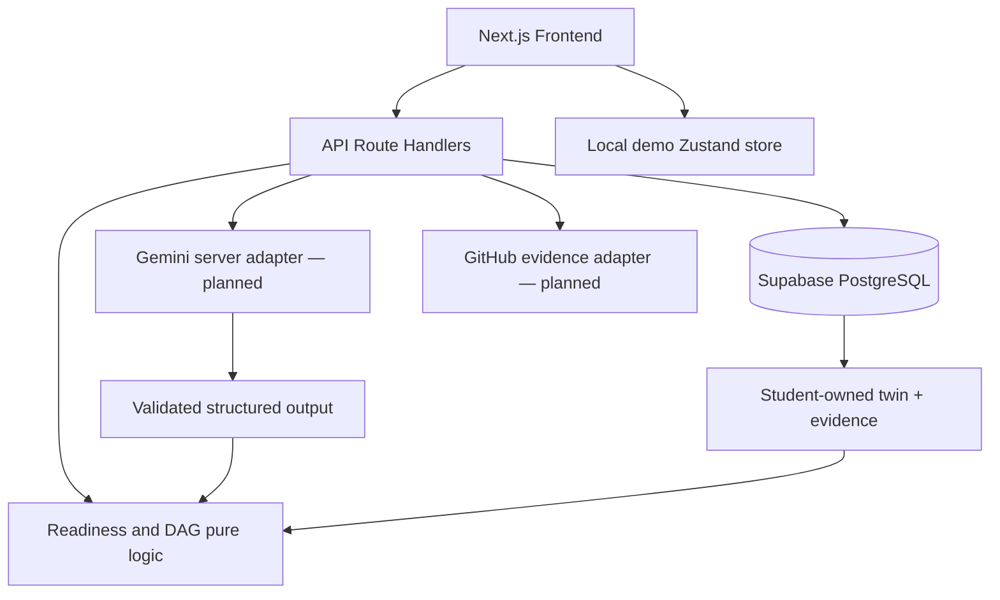

# System architecture

## Source of truth
- `src/data/catalog.ts` contains 3 curated roles, skills, prerequisites, mission templates and **demo-only** quiz items.
- `src/lib/readiness.ts` is pure, deterministic logic. Production will derive server-authoritative proficiency from trusted review events, not client-submitted scores.
- `src/store/use-skillmetry.ts` remains the anonymous browser demo cache. For authenticated students, it hydrates after mount and synchronizes only claimed profile fields through `/api/profile`.
- Supabase Auth sessions use cookies through `@supabase/ssr`. Middleware refreshes tokens; protected pages and private API routes authorize with validated claims, never the unverified client session object.
- PostgreSQL is authoritative for authenticated profiles and claimed skill rows. RLS and column grants provide a second authorization boundary.

## Domain rules
- Every career has positive weighted skills summing to 100.
- Every prerequisite references an existing canonical skill; graph is acyclic.
- A scenario selects approved missions from the requested career and adjusts a *copy* of the skill map.
- A role-specific readiness index is weighted coverage, not a probability of employment.
- Quizzes add weak proficiency signals; production needs reviewed question bank, backend grading and tamper protection.
- Mission deliverables and linked repositories may inform review but never instantly award verification.

## Routes
- `/`: marketing landing.
- `/onboarding`: goal and baseline.
- `/dashboard`, `/careers`, `/roadmap`, `/twin`, `/simulator`, `/missions`, `/assessments`, `/jobs`, `/passport`, `/settings`: workspace screens.
- `GET /api/health`: readiness endpoint.
- `POST /api/simulate`: Zod-validated deterministic scenario.
- `POST /api/jobs/analyze`: 501 until server AI service implemented.
- `POST /api/ai/missions`: 501 until structured generation implemented.

## Production migration plan
1. ~~Add Supabase Auth and SSR session integration.~~ Implemented in Phase 2A.
2. ~~Seed curated catalog tables transactionally; version source and weight datasets.~~ Implemented in migration `0003`.
3. Add trusted review-event writers. Student sessions are already prevented from writing demonstrated/verified fields.
4. Move assessments and question keys to backend; enforce expiry, attempt limits and audits.
5. Enable AI on server only with Zod/JSON-schema validation, prompt-injection resistance, usage quotas and safe logging.
6. Implement evidence evaluation by transparent rules/ratings and human review for ambiguous work.
7. Publish passports using an explicit opt-in public view, not direct grants on private tables.

## Data flow: what-if
UI selection → copy skill map → apply capped gains → role-weighted calculation → display hypothetical delta. Do **not** write to `user_skills`.

## Data flow: real achievement (target)
Student submits evidence/quiz → backend evaluates rules/rubric → trusted assessment event or pending review → server recomputes demonstrated proficiency and confidence → user twin changes → roadmap recommendations refresh. No AI or client gets direct write access to verified status.
